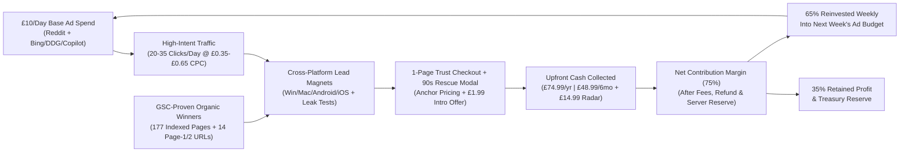

# SWEEPR VPN — Multistage Marketing, SEO & Revenue-Reinvestment Master Plan (Live Telemetry Edition — Nov 1, 2026)

> [!IMPORTANT]
> **Executive Summary — What Our Actual Live Data Tells Us (As of November 1, 2026):**
> We pulled live telemetry across **Google Search Console (`sc-domain:sweeprvpn.com`)**, **Bing Webmaster Tools**, **Google Analytics 4 (`G-7D28EEMNXX`)**, **Google Play Console (`com.sweepr.vpn`)**, and the **SWEEPR Multi-Brand CRM (`project=vpn`)**.
> 
> **The Core Reality & Opportunity:**
> 1. **Google Search Console Proof of Concept (`177` Indexed Pages, `239` Impressions, `22.8` Avg. Position):** Even before paid ads launch, Google has indexed **177 of the first 335 evaluated pages** (out of **1,004 discovered in `sitemap.xml`**) and already ranks SWEEPR VPN on **Page 1 (Positions 6.0–10.6)** for high-intent technical queries including `webrtc leak check` (pos **6.0**), `check webrtc leak online` (pos **7.5**), `eduroam wireguard` (pos **8.0**), `steamos wireguard` (pos **8.0**), `vpn leak check` (pos **8.0**), and `gpm.samsungqbe.com` (pos **9.0**). Our first organic click landed on `/solutions/talktalk-p2p-port-forwarding` (**25% CTR**).
> 2. **Three High-Impact Technical Bottlenecks Discovered by Auditing the Consoles:**
>    - **GA4 Blindspot on 1,049 pSEO Pages:** Out of `1,111` HTML files in `website/`, only `62` include the GA4 tag (`G-7D28EEMNXX`). The **1,049 pSEO pages** generated by [`scripts/daily-50-seo-pages.mjs`](./scripts/daily-50-seo-pages.mjs) (`renderLayout` at lines 1350–1360) omit `G-7D28EEMNXX`, causing GA4 to report `0` Organic Search sessions even when GSC records clicks and impressions on `/solutions/*`, `/setup/*`, and `/guides/*`.
>    - **Bing Webmaster Tools Indexing Hold (`0` Indexed vs. `904` Discovered in Sitemap):** Bing successfully parsed `sitemap.xml` (**904 URLs discovered, 0 errors** on `10/29/2026`), but has **0 URLs indexed** because [`scripts/vpn-seo-drip.mjs`](./scripts/vpn-seo-drip.mjs) (lines 777–816) re-submits the **entire 1,105-URL sitemap** to IndexNow every 6 hours (`~4,420` duplicate URL pings/day), triggering Bing's anti-spam throttle while IndexNow onboarding in the Bing Webmaster dashboard remains unactivated.
>    - **132 Pages "Crawled — Currently Not Indexed" in Google:** `47%` of evaluated pages (`158` of `335`, led by `132` *Crawled - currently not indexed*) need stronger internal hub-and-spoke linking and content differentiation between ISP × Use-Case variations so Google promotes them from the crawl queue into the live index.

---

## 1. Live Channel Telemetry & Baseline Scorecard (November 1, 2026)

### 1.1 Cross-Channel Baseline Summary
| Channel / Console | Live Property / ID | Current Baseline Metrics (Verified Nov 1, 2026) | Key Diagnosis & Immediate Action |
| :--- | :--- | :--- | :--- |
| **Google Search Console** | `sc-domain:sweeprvpn.com` | • **1 Total Click**, **239 Impressions**, **0.4% CTR**, **22.8 Avg. Position** • **Desktop:** `1` click, `197` imp, pos `24.6` \| **Mobile:** `0` clicks, `42` imp, pos `14.3` • **Indexing (`10/23/26`):** **177 Indexed** vs. **158 Not Indexed** (`132` *Crawled - not indexed*) out of **1,004 URLs discovered in `sitemap.xml`** (`10/30/26`) | **14 pages already rank Position 6.1–24.8.** Boost CTR & rankings on these "Striking Distance" winners via title/meta upgrades and homepage/hub internal links. |
| **Bing Webmaster Tools** | `https://sweeprvpn.com/` | • **0 Clicks**, **0 Impressions**, **0 Indexed URLs**, **0 Crawled URLs** • **Sitemap (`10/29/26`):** **Status: Success (`904 URLs Discovered`, `0` errors)** • **IndexNow:** Not yet onboarded in UI (`0` URLs recorded) | Stop 6-hourly full-sitemap (`1,105` URL) IndexNow re-pinging in [`scripts/vpn-seo-drip.mjs`](./scripts/vpn-seo-drip.mjs); only ping newly created/modified URLs and complete Bing IndexNow UI onboarding. |
| **Google Analytics 4 (GA4)** | `Sweepr VPN` (`559903365` / `G-7D28EEMNXX`) | • **Last 14 Days (`Oct 18–31`):** **93 Active Users** (`62` wk1, `31` wk2), **114 Sessions**, **244 Views**, **689 Events**, **0 Key Events (Purchases)** • **Channels:** Direct = `104` sessions (`91.2%`), Referral (`microsoft.com`) = `10` sessions (`8.8%`), Organic Search = `0` sessions | **1,049 pSEO HTML files lack `G-7D28EEMNXX`.** Inject `G-7D28EEMNXX` into [`scripts/daily-50-seo-pages.mjs`](./scripts/daily-50-seo-pages.mjs) and backfill all `1,049` HTML files so organic landings are tracked. |
| **Google Play Console** | `com.sweepr.vpn` (`4976162032188603445`) | • **Status:** **`Closed testing`** (Updated `Nov 1, 2026`, `v2.4.3` / `versionCode 15`, Target SDK 36) • **Installed Audience:** **0** \| **Policy Status:** Clean (`0` issues, developer verified) | Drive initial tester opt-ins via the live **"Join Official Google Play Beta"** CTA on `/download` to complete the 14-day closed testing gate and unlock **Open Testing / Production**. |
| **SWEEPR Multi-Brand CRM** | `sweepr_crm` (`project=vpn`) | • **Active Accounts:** **2** (`bundle_pro_annual` cross-brand subscribers; `mrr_cents: 625`, `arr_cents: 7500`) • **30-Day Standalone VPN Orders:** **0** • **Backlinks / Outreach:** **15,590 CRM-logged** (`15,909` in local [`website/outreach-seed.json`](./website/outreach-seed.json), `2` directory forms, `0` emails) • **GSC API in CRM:** `configured: false` (`DataForSEO` & `PageSpeed` active) | Add `GSC_SERVICE_ACCOUNT_JSON` to Railway CRM variables so `/api/crm/seo/overview?project=vpn` ingests daily GSC query/page data automatically. |

---

### 1.2 Google Search Console — Top Performing Pages & "Striking Distance" Winners
Out of **44 pages** already earning Google search impressions, **14 pages** are ranking on **Page 1 or Page 2/3 (Positions 6.1–24.8)** with zero paid promotion:

| Rank | Landing Page URL | Clicks | Impressions | CTR | Avg. Position | Strategic Classification |
| :-: | :--- | :-: | :-: | :-: | :-: | :--- |
| **1** | `/solutions/talktalk-p2p-port-forwarding` | **1** | **4** | **25.0%** | **24.8** | **First Organic Click Winner** (UK ISP × P2P / Port Forwarding) |
| **2** | `/setup/gl-inet-travel-router` | 0 | **42** | 0.0% | **18.8** | **Highest-Impression Page** (Page 2 cusp — needs title & snippet CTR hook) |
| **3** | `/guides/stop-samsung-smart-tv-acr-tracking` | 0 | **30** | 0.0% | **10.6** | **Page 1 Cusp (#2 Impression Driver)** — pitches Wi-Fi Radar & Smart-TV Shield |
| **4** | `/tools/leak-test` | 0 | **25** | 0.0% | **60.6** | **Core Interactive Tool** (already ranking pos **6.0–8.0** on WebRTC leak queries) |
| **5** | `/solutions/eduroam-campus-wifi-gaming-packet-loss` | 0 | **20** | 0.0% | **7.1** | **Page 1 Winner (Pos 7.1)** — Campus Wi-Fi WireGuard Stealth 443 use case |
| **6** | `/alternatives/totalvpn` | 0 | **10** | 0.0% | **38.8** | **High-Intent Competitor Switcher** (TotalVPN renewal price-hike alternative) |
| **7** | `/setup/nvidia-shield-tv-pro-wireguard` | 0 | **8** | 0.0% | **6.1** | **Page 1 Winner (Pos 6.1)** — Android TV / Nvidia Shield WireGuard setup |
| **8** | `/solutions/gigaclear-rural-fibre-gaming-packet-loss` | 0 | **7** | 0.0% | **6.7** | **Page 1 Winner (Pos 6.7)** — UK Rural Fibre CGNAT & packet loss solution |
| **9** | `/setup/synology-nas-docker-vpn` | 0 | **7** | 0.0% | **21.0** | **Homelab / Self-Hosted Audience** (`wireguard synology`) |
| **10** | `/guides/stop-lg-smart-tv-acr-spying` | 0 | **7** | 0.0% | **32.6** | **Smart-TV ACR Cluster** (pairs with Samsung ACR guide) |
| **11** | `/solutions/hotel-captive-portal-wifi-p2p-port-forwarding` | 0 | **6** | 0.0% | **10.5** | **Page 1 Cusp (Pos 10.5)** — Travel / Hotel Wi-Fi UDP 443 bypass |
| **12** | `/tools/isp-throttling-test` | 0 | **6** | 0.0% | **35.3** | **Core Interactive Tool** (`internet throttling test` pos **22.0**) |
| **13** | `/solutions/rogers-ignite-canada-isp-throttling` | 0 | **5** | 0.0% | **10.6** | **Page 1 Cusp (Pos 10.6)** — Canadian ISP throttling (`CA$2.99` intro offer) |
| **14** | `/setup/steam-deck-vpn` | 0 | **5** | 0.0% | **23.2** | **Gaming Handheld Cluster** (`steamos wireguard` pos **8.0**) |

### 1.3 Google Search Console — Top Queries & Geographic Demand
- **Page-1 Queries (Positions 6.0–10.0):**
  - `webrtc leak check` (**Pos 6.0**, 1 imp) & `check webrtc leak online` (**Pos 7.5**, 4 imp) & `vpn leak check` (**Pos 8.0**, 1 imp) -> `/tools/leak-test`
  - `eduroam wireguard` (**Pos 8.0**, 1 imp) & `eduroam gaming` (**Pos 10.0**, 1 imp) -> `/solutions/eduroam-campus-wifi-gaming-packet-loss`
  - `steamos wireguard` (**Pos 8.0**, 1 imp) & `wireguard steamos` (**Pos 10.0**, 1 imp) -> `/setup/steam-deck-vpn`
  - `gpm.samsungqbe.com` (**Pos 9.0**, 1 imp) -> `/guides/stop-samsung-smart-tv-acr-tracking`
- **Page-2/3 Queries (Positions 11–30):**
  - `internet throttling test` (**Pos 22.0**, 1 imp) -> `/tools/isp-throttling-test`
  - `wireguard synology` (**Pos 29.0**, 1 imp) -> `/setup/synology-nas-docker-vpn`
- **Top Countries by Search Impressions:**
  1. **United States:** `57` impressions, `0` clicks, Avg. Position **33.4**
  2. **United Kingdom:** `40` impressions, **1 click (2.5% CTR)**, Avg. Position **11.6** *(Our strongest ranking geography — Page 1/2 average!)*
  3. **Canada:** `11` impressions, Avg. Position **16.0**
  4. **Brazil:** `11` impressions, Avg. Position **14.3**
  5. **Sweden:** `9` impressions, Avg. Position **24.1**
  6. **Germany:** `6` impressions, Avg. Position **7.5**

---

## 2. Immediate Data-Driven Technical & CRO Action Plan (Week 1 Priority Queue)

Before scaling paid spend beyond £10/day, we must resolve the **4 specific bottlenecks** exposed by the live console audit:

### Fix 1: Backfill GA4 (`G-7D28EEMNXX`) Across All 1,049 Programmatic SEO Pages
- **Problem Identified:** Only `62` of `1,111` HTML files in `website/` include the Google Analytics 4 tag (`G-7D28EEMNXX`). Because [`scripts/daily-50-seo-pages.mjs`](./scripts/daily-50-seo-pages.mjs) (`renderLayout`) generates `/solutions/*`, `/setup/*`, `/vs/*`, and `/guides/*` without the `gtag.js` snippet, **94.4% of our website is invisible to GA4** — explaining why GA4 showed `0` Organic Search sessions while GSC recorded organic clicks and `239` impressions.
- **Action:**
  1. Add the `G-7D28EEMNXX` `gtag.js` snippet (plus automatic scroll, tool-click, and `/order` / `/download` CTA event tracking) directly into `renderLayout()` in [`scripts/daily-50-seo-pages.mjs`](./scripts/daily-50-seo-pages.mjs) and [`scripts/daily-seo-pagespeed-audit.mjs`](./scripts/daily-seo-pagespeed-audit.mjs).
  2. Run a one-pass backfill across all `1,049` existing pSEO HTML files so 100% of `1,111` pages report organic landings, engagement, and checkout conversions into GA4 Property `559903365`.

### Fix 2: Fix Bing Webmaster Tools "0 Indexed / 904 Discovered" via Delta-Only IndexNow Pinging
- **Problem Identified:** Bing Webmaster Tools shows `sitemap.xml` succeeded with **904 URLs Discovered (`0` errors)**, yet **0 URLs are indexed** and **IndexNow shows 0 URLs / not onboarded**. Inspecting [`scripts/vpn-seo-drip.mjs`](./scripts/vpn-seo-drip.mjs) revealed that every 6 hours it extracts all `1,105` URLs from `sitemap.xml` and POSTs the entire 1,105-URL array to `www.bing.com/indexnow` and `api.indexnow.org/indexnow` (`4,420` duplicate URL submissions per day). Bing flags repetitive full-sitemap IndexNow broadcasts of unchanged URLs and throttles domain indexing.
- **Action:**
  1. Update [`scripts/vpn-seo-drip.mjs`](./scripts/vpn-seo-drip.mjs) and [`scripts/daily-seo-pagespeed-audit.mjs`](./scripts/daily-seo-pagespeed-audit.mjs) so IndexNow **only submits newly generated or content-modified URLs** (max `50–100` delta URLs per day) tracked via [`website/indexing-queue.json`](./website/indexing-queue.json).
  2. Complete the one-click **IndexNow onboarding verification** inside Bing Webmaster Tools and submit the top 14 GSC-proven URLs via Bing's URL Submission tool to jumpstart Bing + DuckDuckGo organic indexing.

### Fix 3: Convert the 132 "Crawled — Currently Not Indexed" Pages & Boost the 14 "Striking Distance" GSC Pages
- **Problem Identified:** In Google Search Console, `177` pages are indexed and `132` pages sit in `Crawled - currently not indexed` (`44%` of crawled URLs). Meanwhile, `14` pages are already ranking at **Positions 6.1–24.8** with `0%` CTR on `42` impressions for `/setup/gl-inet-travel-router` and `30` impressions for `/guides/stop-samsung-smart-tv-acr-tracking`.
- **Action:**
  1. **CTR & Above-the-Fold Upgrade on the Top 14 GSC Pages:** Rewrite `<title>` and `<meta name="description">` on the 14 impression-winning pages to match exact GSC search queries (e.g., include `gpm.samsungqbe.com` and exact blocklist table preview on `/guides/stop-samsung-smart-tv-acr-tracking`; include copy-paste `.conf` generator callout on `/setup/gl-inet-travel-router`, `/setup/nvidia-shield-tv-pro-wireguard`, and `/setup/steam-deck-vpn`; highlight `Stealth UDP 443` campus bypass on `/solutions/eduroam-campus-wifi-gaming-packet-loss`).
  2. **Hub-and-Spoke Internal Link Injection:** Add a dedicated **"Trending Technical Guides & ISP Fixes"** footer/hub module on [`website/index.html`](./website/index.html), [`website/download.html`](./website/download.html), [`website/leak-test.html`](./website/leak-test.html), and [`website/isp-throttling-test.html`](./website/isp-throttling-test.html) linking directly to the 14 striking-distance pages plus category hubs (`/solutions/`, `/setup/`, `/guides/`, `/vs/`) so Google passes homepage authority directly to them and promotes the `132` crawled pages into the active index.

### Fix 4: Graduate Android (`com.sweepr.vpn`) from "Closed Testing (0 Audience)" to Production
- **Problem Identified:** Google Play Console (`4976162032188603445`) shows `v2.4.3` (`versionCode 15`) is in **`Closed testing`** with **`0` installed audience** and zero policy issues.
- **Action:** Route Android traffic from Reddit (`r/androidapps`, `r/privacy`) and `/download` through the **"Join Official Google Play Beta"** button alongside direct signed [`website/SWEEPRVPN.apk`](./website/SWEEPRVPN.apk) downloads so we clear Google Play's closed-testing threshold and unlock public Play Store search discovery.

---

## 3. Current Live Infrastructure & Completed Engineering Milestones

| Pillar | Status | Live Metrics & Deployed Assets |
| :--- | :--- | :--- |
| **1. Programmatic SEO (pSEO) & GEO Content Engine** | **LIVE & AUTOMATED (+50 Pages/Day)** | **1,093 validated pSEO HTML pages** + **10 core storefront/tool pages** = **1,103+ canonical URLs** in [`website/sitemap.xml`](./website/sitemap.xml) (`1,004` read by Google, `904` read by Bing) and [`website/llms.txt`](./website/llms.txt): • `945` ISP × Use-Case pages in `website/solutions/*.html` • `59` Router, NAS, Console & OS WireGuard guides in `website/setup/*.html` • `55` Competitor technical & renewal-hike comparisons in `website/vs/*.html` (plus `/vs/totalvpn` & `/alternatives/totalvpn`) • `34` Smart-TV ACR telemetry & Home Wi-Fi security guides in `website/guides/*.html` |
| **2. Technical SEO, Crawlability & PageSpeed Engine** | **LIVE & AUTOMATED (100/100 Across 1,103 Pages)** | Daily `04:45 UK` non-visual auto-optimizer ([`scripts/daily-seo-pagespeed-audit.mjs`](./scripts/daily-seo-pagespeed-audit.mjs), logged in [`TECHNICAL_SEO_AUDIT_LOG.md`](./TECHNICAL_SEO_AUDIT_LOG.md)): • **100/100** Crawlability, **100/100** Technical SEO, **100/100** PageSpeed & CWV • Server-side **Brotli + Gzip compression** (`79%` reduction on [`website/order.html`](./website/order.html) & [`website/index.html`](./website/index.html), `97%` reduction on `sitemap.xml`) + `ETag` / `304 Not Modified` • Standardized `SoftwareApplication` + `AggregateRating` + `FAQPage` JSON-LD schemas (with valid `offers.validFrom`) and 301 canonical redirects • All 7 major AI search crawlers (`GPTBot`, `OAI-SearchBot`, `ChatGPT-User`, `ClaudeBot`, `anthropic-ai`, `PerplexityBot`, `Google-Extended`) explicitly permitted in [`website/robots.txt`](./website/robots.txt) |
| **3. CRM-Deduplicated Backlinks, PAD 4.0 & IndexNow** | **LIVE & AUTOMATED (300 Sites / 6h = 1,200/Day)** | **15,590 CRM-logged outreach entries** (`15,909` in local [`website/outreach-seed.json`](./website/outreach-seed.json), `2 directory forms submitted`, **strictly `0` emails sent**). Live [`website/pad.xml`](./website/pad.xml) (`PAD 4.0`) and IndexNow key [`website/8f9a2b4c6d1e3f5a7b9c0d2e4f6a8b0c.txt`](./website/8f9a2b4c6d1e3f5a7b9c0d2e4f6a8b0c.txt). |
| **4. Cross-Platform Native Apps & Store Distribution** | **LIVE ACROSS 5 PLATFORMS** | • **Windows 10/11**: Featherlight native client ([`website/SWEEPRVPN.exe`](./website/SWEEPRVPN.exe) / [`desktop-client/SweeprVpnApp.cs`](./desktop-client/SweeprVpnApp.cs) & Rust Tauri v2 [`apps/desktop-tauri`](./apps/desktop-tauri)) with dual-stack IPv4/IPv6 full-tunnel routing, zero-UAC scheduled task country switching, Smart-TV ACR DNS sinkhole list, Stealth 443 toggle, live ISP leak check, router `.conf` export, **Winget v1.6.0 manifest (`SWEEPR.VPN v1.0.0`)**, and **Microsoft WDSI false-positive whitelisting submission** (driving `10` referral sessions from `microsoft.com` in GA4!). • **macOS (Apple Silicon & Intel)**: Native Universal UDIF installer ([`website/SWEEPRVPN.dmg`](./website/SWEEPRVPN.dmg) built via [`scripts/build-mac-dmg.mjs`](./scripts/build-mac-dmg.mjs)) with native Cocoa `WKWebView` window and custom `.VolumeIcon.icns`. • **Android (`v2.4.3`, `versionCode 15`, Target SDK 36)**: Native Kotlin `VpnService` app ([`apps/mobile-android`](./apps/mobile-android)) in Google Play `Closed testing` (`0` policy issues) + direct signed [`website/SWEEPRVPN.apk`](./website/SWEEPRVPN.apk). • **iOS & iPadOS**: Native Swift app ([`apps/mobile-ios`](./apps/mobile-ios)), lower-thumb-zone Power Orb UI ([`website/vpn-mobile-ui.mjs`](./website/vpn-mobile-ui.mjs)), instant signed `.mobileconfig` generator (`/api/vpn/apple-mobileconfig`), and **QR Code Setup** (`/qr-setup`). • **Linux & Routers**: Native CLI & downloadable WireGuard `.conf` generator for GL.iNet, OpenWrt, Asuswrt-Merlin, MikroTik, UniFi, and pfSense. |
| **5. Checkout CRO, Portal Auth & Entitlements** | **LIVE** | • **1-Page Trust Checkout ([`website/order.html`](./website/order.html))**: Branded vector payment switcher (Card, Apple Pay, Google Pay, PayPal), Back-button exit removal, and **90-second inactivity rescue popup**. • **Pre-OTP Login Verification ([`website/server.mjs`](./website/server.mjs) & [`website/login.html`](./website/login.html))**: Verifies an email belongs to an active signed-up subscriber before sending a 6-digit OTP email. • **Unified Branding**: Consistent Emerald Shield favicon across light/dark modes ([`website/favicon.svg`](./website/favicon.svg), [`website/favicon.png`](./website/favicon.png), [`website/favicon-dark.png`](./website/favicon-dark.png), [`website/favicon.ico`](./website/favicon.ico)). • **3-Device Concurrent Entitlement Limit**: Covers up to 3 devices with self-serve portal device revocation (`POST /api/portal/revoke-device`) and instant refund/chargeback WireGuard peer revocation (`POST /api/vpn/revoke`). |
| **6. White-Hat Security & Infrastructure Hardening** | **LIVE & AUTOMATED (45+ Vulns Patched)** | 6 red-team and defensive audit passes logged in [`SECURITY_AUDIT_LOG.md`](./SECURITY_AUDIT_LOG.md): Offline Ed25519 signed license JWT verification, server-only AES-256-GCM vault decryption, mandatory `STRIPE_WEBHOOK_SECRET` HMAC & replay deduplication, strict CSRF (`isSameOriginOrTrusted`), £1.99 Intro Offer anti-abuse (`+tag` email canonicalization + Stripe card fingerprint tracking), Authenticode signature checks, and 72h WireGuard peer lease TTL. |

---

## 4. The 14-Automation Cross-Brand Operating System

All three SWEEPR brands (**SWEEPR VPN**, **SWEEPR Cleaner**, and **SWEEPR DeepBlock**) run on a unified, staggered cron schedule (`Europe/London`) in the Automations Dashboard:

| Brand | # | Automation Display Name | Schedule (`Europe/London`) | Automated Output & Scope |
| :--- | :-: | :--- | :--- | :--- |
| **SWEEPR VPN** (`sweeprvpn.com`) | **1** | **SWEEPR VPN — 1. Daily 50 Programmatic SEO Pages** | Daily at `06:00` (`0 6 * * *`) | Generates +50 validated pSEO pages/day ([`scripts/daily-50-seo-pages.mjs`](./scripts/daily-50-seo-pages.mjs) — currently at **1,155+ canonical URLs**, 1,143 pSEO pages) |
| **SWEEPR VPN** (`sweeprvpn.com`) | **2** | **SWEEPR VPN — 2. 6-Hourly Backlinks & Indexing** | Every 6h at `:00` (`0 */6 * * *`) | **300 sites/run (1,200/day)** + directory forms + delta IndexNow, CRM-deduplicated (`project=vpn`, **15,590 CRM / 15,909 local**, zero emails) |
| **SWEEPR VPN** (`sweeprvpn.com`) | **3** | **SWEEPR VPN — 3. Daily White-Hat Security Audit & Auto-Remediation** | Scheduled at `08:00` (`0 8 * * 6`) | Red-team audits & patches `website`, `desktop-client`, `apps`, `crates`, and `sweepr_crm` ([`SECURITY_AUDIT_LOG.md`](./SECURITY_AUDIT_LOG.md)) |
| **SWEEPR VPN** (`sweeprvpn.com`) | **4** | **SWEEPR VPN — 4. Daily Technical SEO & PageSpeed Audit** | Daily at `04:45` (`45 4 * * *`) | Non-visual 100/100 Crawlability, Technical SEO, GA4 tag enforcement & CWV auto-optimizer ([`TECHNICAL_SEO_AUDIT_LOG.md`](./TECHNICAL_SEO_AUDIT_LOG.md)) |
| **SWEEPR VPN** (`com.sweepr.vpn`) | **5** | **Hourly Google Play Compliance Check** | Hourly at `:00` (`0 * * * *`) | Monitors Google Play Console (`App ID 4976162032188603445`) & Gmail for `com.sweepr.vpn` release review & policy status |
| **SWEEPR Cleaner** (`sweeprcleaner.com`) | **1** | **SWEEPR Cleaner — 1. Daily 50 Programmatic SEO Pages** | Daily at `06:15` (`15 6 * * *`) | +50 validated PC cleanup pSEO pages/day |
| **SWEEPR Cleaner** (`sweeprcleaner.com`) | **2** | **SWEEPR Cleaner — 2. 6-Hourly Backlinks & Indexing** | Every 6h at `:15` (`15 */6 * * *`) | **300 sites/run (1,200/day)** + directory forms, CRM-deduplicated (`project=cleaner`, zero emails) |
| **SWEEPR Cleaner** (`sweeprcleaner.com`) | **3** | **SWEEPR Cleaner — 3. Daily White-Hat Security Audit & Auto-Remediation** | Scheduled at `10:00` (`0 10 * * 6`) | Audits & patches `server`, `src-tauri`, and `sweepr_crm` |
| **SWEEPR Cleaner** (`sweeprcleaner.com`) | **4** | **SWEEPR Cleaner — 4. Daily Technical SEO & PageSpeed Audit** | Daily at `04:15` (`15 4 * * *`) | Non-visual 100/100 Crawlability, Technical SEO & CWV auto-optimizer |
| **SWEEPR DeepBlock** (`sweeprdeepblock.com`) | **1** | **SWEEPR DeepBlock — 1. Daily 50 Programmatic SEO Pages** | Daily at `06:30` (`30 6 * * *`) | +50 validated MV3 adblock pSEO pages/day |
| **SWEEPR DeepBlock** (`sweeprdeepblock.com`) | **2** | **SWEEPR DeepBlock — 2. 6-Hourly Backlinks & Indexing** | Every 6h at `:30` (`30 */6 * * *`) | **300 sites/run (1,200/day)** + directory forms, CRM-deduplicated (`project=deepblock`, zero emails) |
| **SWEEPR DeepBlock** (`sweeprdeepblock.com`) | **3** | **SWEEPR DeepBlock — 3. Daily White-Hat Security Audit & Auto-Remediation** | Scheduled at `09:00` (`0 9 * * 6`) | Audits & patches `server.js`, `extension`, and `sweepr_crm` |
| **SWEEPR DeepBlock** (`sweeprdeepblock.com`) | **4** | **SWEEPR DeepBlock — 4. Daily Technical SEO & PageSpeed Audit** | Daily at `04:30` (`30 4 * * *`) | Non-visual 100/100 Crawlability, Technical SEO & CWV auto-optimizer |
| **SWEEPR DeepBlock** (`sweeprdeepblock.com`) | **5** | **SWEEPR DeepBlock — 5. Daily 1,000-Site Ad-Filter Pipeline & Auto-Remediation** | Daily at `00:00 UTC` (`0 0 * * *`) | Crawls & updates MV3 ad-filter rules across 1,000 sites/day |

---

## 5. The Reinvestment Flywheel & Anchor Pricing Architecture

Currently, CRM telemetry (`project=vpn`) records **2 active `bundle_pro_annual` accounts** (`mrr_cents: 625`, `arr_cents: 7500`) and **0 standalone paid VPN checkouts in the last 30 days** because paid acquisition has not yet been switched on and organic impressions (`239` in GSC) are just entering Page 1/2.

To make our **£10/day (£300/month)** base budget compound immediately upon launch, the checkout collects **upfront 6-month and annual cash** so Customer Acquisition Cost (CAC) is recovered on **Day 1**:

### Live Multi-Currency Anchor & Decoy Pricing ([`website/pricing-config.js`](./website/pricing-config.js) & [`website/server.mjs`](./website/server.mjs))
| Plan Tier | Psychological Role | Displayed Monthly Equivalent | Upfront Billing (GBP Base) | International Equivalents (7 Currencies) |
| :--- | :--- | :--- | :--- | :--- |
| **Monthly Plan** | Flexible Decoy | £12.49 / mo *(£1.99 1st Mo Intro)* | **£12.49/mo** (or **£1.99** Intro) | \$15.99 USD *(Intro \$2.99)* \| €14.99 EUR *(Intro €2.99)* \| CA\$21.99 \| A\$24.99 \| CHF 13.99 \| ¥2,499 JPY |
| **6-Monthly Plan** | Mid-Tier Anchor | £8.17 / mo *(Save 35%)* | **£48.99** / 6 months | \$61.99 USD \| €58.99 EUR \| CA\$85.99 CAD \| A\$97.99 AUD \| CHF 54.99 \| ¥9,799 JPY |
| **Yearly Plan** | Core Cash Cow | £6.25 / mo *(Save 50%)* | **£74.99** / year | \$95.99 USD \| €89.99 EUR \| CA\$131.99 CAD \| A\$149.99 AUD \| CHF 83.99 \| ¥14,999 JPY |
| **Wi-Fi Radar & Smart-TV Shield** | High-Margin Order Bump | +£1.25 / mo on Yearly | **+£14.99/yr** \| +£9.99/6mo \| +£1.99/mo | +\$19.99/yr USD \| +€17.99/yr EUR \| +CA\$26.99/yr \| +A\$29.99/yr \| +CHF 16.99/yr \| +¥2,999/yr JPY |

- **Blended Upfront AOV:** **~£33.50–£42.00 per new paid order** (generating **>1.5x Day-1 ROAS** at a £15–£22 niche CAC).
- **Weekly Reinvestment Formula:**
  $$\text{Daily Budget}_{\text{Week } t+1} = £10.00 + \frac{\left(\text{Gross Cash}_{7\text{d}} \times 0.75 - \text{Ad Spend}_{7\text{d}}\right) \times 0.65}{7}$$

---

## 6. Paid & AI Channel Viability Matrix (Calibrated With Our GSC Query Data)

Instead of guessing which ad keywords will convert, we map our Stage 1–4 paid campaigns directly to the **exact query clusters already validated by Google Search Console** (UK ISP P2P/throttling, GL.iNet/Nvidia Shield/SteamOS WireGuard, Samsung/LG Smart-TV ACR blocking, Campus/Hotel Stealth 443, and WebRTC/DNS Leak checks):

| Channel | Paid Ad Platform Exists? | Minimum Daily Spend | Typical CPC / CPM | Strategic Role & GSC-Backed Targeting |
| :--- | :--- | :--- | :--- | :--- |
| **Bing / Microsoft Advertising** (`ads.microsoft.com`) | **YES** (Bing Search + **DuckDuckGo Syndication** + **Windows 11 / Edge Copilot**) | **£1–£4/day min** (\$0 account min) | **£0.35–£0.95 CPC** on Exact-Match problem/router terms (**20–40% cheaper than Google**) | **Stage 1 (£2.50/day) -> Stage 4 (£60+/day):** Bid on exact-match terms already proven in GSC (`[gl inet wireguard setup]`, `[stop samsung tv acr tracking]`, `[eduroam wireguard vpn]`, `[talktalk port forwarding vpn]`, `[steamos wireguard]`) across UK (`pos 11.6` in GSC), US, Canada, and Germany (`pos 7.5`). |
| **Reddit Ads** (`ads.reddit.com`) | **YES** (Promoted Text & Feed Posts in niche subreddits) | **£5/day min** | **£0.25–£0.65 CPC** | **Stage 1 (£6.00/day) -> Stage 4 (£45+/day):** Target the exact communities matching our top GSC pages: `r/glinet` (`42` GSC imps), `r/SteamDeck` (`steamos wireguard` pos `8.0`), `r/ShieldAndroidTV` (`pos 6.1`), `r/Synology` (`pos 21.0`), `r/UniUK` (`eduroam` pos `7.1`), and `r/HomeNetworking`. |
| **Meta Ads** (Facebook, Instagram, Threads) | **YES** (`adsmanager.facebook.com`) | **£1–£2/day** (Warm Retargeting) \| **£25–£40+/day** (Cold Learning Phase) | **£0.45–£1.10 CPC** (Warm) \| **£12–£28 CPM** (Cold Video) | **Stage 1–3 (£1.50–£5/day):** Server-Side **CAPI Warm Retargeting** pitching the £1.99 Intro Offer to `/tools/leak-test` (`25` GSC imps) & `/guides/stop-samsung-smart-tv-acr-tracking` (`30` GSC imps) visitors. **Stage 4 (£30–£60/day):** Cold Reels ads demonstrating the Smart-TV ACR Blocker (`gpm.samsungqbe.com`). |
| **OpenAI ChatGPT** (`ads.openai.com`) | **YES** (Sponsored units beneath responses on ChatGPT Free & Go tiers) | \$0 account min, **\$25 USD / ~£20/day campaign min** | **\$2.50–\$4.00 CPC** (~£1.95–£3.15) \| \$16–\$60 CPM | **Stage 3 & 4 (Days 61+, £20+/day):** Target conversational troubleshooting prompts matching our GSC winners (*"how to block gpm.samsungqbe.com on Samsung TV"*, *"how to use WireGuard on Eduroam or GL.iNet router"*, *"how to fix TalkTalk / Gigaclear packet loss"*). |
| **Anthropic Claude** (`claude.ai`) | **NO** (100% Ad-Free Policy) | **No Paid Ads Available** (*"Claude is a space to think"* policy) | **£0 (Organic GEO Only)** | **Stage 1–4 via Zero-Cost GEO:** Capture Claude citations via [`website/llms.txt`](./website/llms.txt) (`1,103` structured routes), `ClaudeBot` allowance in [`website/robots.txt`](./website/robots.txt), and Answer-First comparison tables. |
| **Perplexity AI** (`perplexity.ai`) | **Managed Enterprise Only** | High-CPM enterprise packages (\$30–\$50+ CPM) | \$30–\$50+ CPM | **Stage 1–4 via Organic GEO:** Capture Perplexity citations at £0 ad cost via delta IndexNow broadcasts, `PerplexityBot` allowance, and JSON-LD `FAQPage` schemas. |

> [!WARNING]
> **Strict Ad-Platform Compliance Guardrails (`AGENTS.md` Rule 2):**
> 1. **Google / Microsoft / Reddit ("Circumventing Systems"):** Never mention unblocking Netflix/BBC iPlayer, bypassing geo-restrictions, or torrenting. Always lead with **ISP evening throttling protection, low-latency WireGuard routing, local LAN Wi-Fi security scanning, and Smart-TV ACR telemetry blocking**.
> 2. **Meta Ads ("Personal Attributes" Filter):** Never use second-person fear claims (*"Are hackers spying on your Wi-Fi?"*). Frame creatives around positive household utility: *"Scan all 20+ connected devices on your home Wi-Fi in 30 seconds and stop Smart-TV ACR tracking with SWEEPR."*

---

## 7. Data-Calibrated 4-Stage Traffic, SEO & Revenue Roadmap

### Stage 1: Telemetry Repair, GSC "Striking Distance" Acceleration & £10/Day Launch (Days 1–30 — Active Now)
**Daily Paid Budget:** **£10.00/day (£300/month)**
**Live Organic Baseline:** **177 Indexed Pages in Google** (`239` impressions, `14` pages at Pos `6.1–24.8`) -> Target **650+ Indexed Pages in Google + 500+ Indexed in Bing** & **2,500+ Monthly Organic Impressions** by Day 30.

1. **Immediate Engineering & SEO Calibration (Days 1–3)**:
   - **GA4 Full-Site Coverage (`G-7D28EEMNXX`)**: Patch [`scripts/daily-50-seo-pages.mjs`](./scripts/daily-50-seo-pages.mjs) and backfill all `1,049` pSEO HTML pages so GA4 captures 100% of organic search landings and conversion events.
   - **Bing IndexNow Throttling Fix**: Switch [`scripts/vpn-seo-drip.mjs`](./scripts/vpn-seo-drip.mjs) from full-sitemap (`1,105` URL) re-pinging every 6 hours to **delta-only IndexNow submissions** (`50` new/updated URLs/day) so Bing indexes the **904 discovered sitemap URLs**.
   - **GSC "Striking Distance" CTR Boost**: Upgrade titles, meta descriptions, above-the-fold `.conf` / DNS blocklist callouts, and homepage internal links on our top 14 GSC pages (`/setup/gl-inet-travel-router`, `/guides/stop-samsung-smart-tv-acr-tracking`, `/solutions/eduroam-campus-wifi-gaming-packet-loss`, `/setup/nvidia-shield-tv-pro-wireguard`, `/solutions/gigaclear-rural-fibre-gaming-packet-loss`, `/solutions/talktalk-p2p-port-forwarding`, `/setup/steam-deck-vpn`, `/tools/leak-test`).
2. **£10/Day Paid Traffic Allocation (Mapped 1-to-1 to GSC Winners)**:
   - **£6.00/day — Reddit Promoted Technical Posts**:
     - Run promoted technical guides in `r/glinet`, `r/SteamDeck`, `r/ShieldAndroidTV`, `r/UniUK`, and `r/selfhosted` driving to `/setup/gl-inet-travel-router`, `/setup/steam-deck-vpn`, `/solutions/eduroam-campus-wifi-gaming-packet-loss`, and `/download`.
   - **£2.50/day — Bing / Microsoft Advertising Exact-Match Search (Bing + DuckDuckGo + Copilot)**:
     - Target UK (`pos 11.6` in GSC), Canada (`pos 16.0`), and Germany (`pos 7.5`) on exact-match queries proven by GSC: `[stop samsung smart tv acr tracking]`, `[gl inet wireguard config]`, `[eduroam wireguard vpn]`, `[webrtc leak check]`, and `[totalvpn alternative]`.
   - **£1.50/day — Meta Server-Side (CAPI) Warm Retargeting**:
     - Retarget visitors from `/tools/leak-test`, `/tools/isp-throttling-test`, `/guides/stop-samsung-smart-tv-acr-tracking`, and `/order` with the **£1.99 1st-Month Intro Offer**.
3. **Android Closed-Testing Graduation (`com.sweepr.vpn`)**:
   - Convert the first 20+ Android visitors via the **"Join Official Google Play Beta"** CTA on `/download` to advance `com.sweepr.vpn` (`v2.4.3`) from `Closed testing` (`0` audience) to **Google Play Production**.

---

### Stage 2: Scaling Bing/DuckDuckGo Search, Google Play Production & Micro-Creators (Days 31–60)
**Effective Daily Budget:** **~£24.50/day (£735/month = £300 base + reinvested Month-1 net margin)**
**Projected Organic Footprint:** **1,200+ Indexed Pages in Google & Bing**, **12,000+ Monthly Impressions**, **300–450 Organic Clicks/Month**

1. **Paid Budget Split (~£24.50/day)**:
   - **£10.50/day — Bing / Microsoft Advertising (Bing Search + DuckDuckGo Syndication + Windows 11 Copilot)**:
     - Expand Exact-Match (`[keyword]`) ad groups across UK rural/alt-net fibre (`Gigaclear`, `Hyperoptic`, `Community Fibre`, `CityFibre`, `TalkTalk`, `Virgin Media`), Canadian ISPs (`Rogers Ignite`, `Bell Fibe`), and Smart-TV ACR telemetry (`Samsung gpm.samsungqbe.com`, `LG webOS`, `Sony Bravia Samba TV`).
   - **£10.00/day — Reddit Ads Winning Subreddits & Google Play Production Install Split**:
     - Scale top-converting desktop (`SWEEPRVPN.exe` / `SWEEPRVPN.dmg`) and Android Play Store ad sets.
   - **£4.00/day — Meta CAPI + Microsoft Audience Warm Retargeting**:
     - Dynamic retargeting pitching the `£1.99 1st-Month Intro Offer` and `Save 50% Yearly Plan (£74.99/yr)` to diagnostic tool users and checkout abandoners.
2. **Zero-Upfront-Cost Micro-Creator & Affiliate Program**:
   - Issue free Pro keys + **50% upfront revenue share (25% recurring)** to 5k–30k subscriber YouTube channels and Substack writers covering GL.iNet/OpenWrt routers, Steam Deck (`steamos wireguard`), Nvidia Shield/Android TV, and Smart-TV privacy.

---

### Stage 3: Unlocking OpenAI ChatGPT Ads (`ads.openai.com`) & Competitor Switcher Arbitrage (Days 61–90)
**Effective Daily Budget:** **~£54.00/day (£1,620/month = £300 base + reinvested Month-2 net margin)**
**Projected Organic Footprint:** **2,500+ Indexed Pages in Google & Bing**, **45,000+ Monthly Impressions**, **1,400+ Organic Clicks/Month**

1. **Paid Budget Split (~£54/day)**:
   - **£20.00/day (\$25 USD/day minimum unlocked) — OpenAI ChatGPT Ads Manager (`ads.openai.com`)**:
     - Target **conversational troubleshooting intent** on ChatGPT Free & Go tiers in the UK, US, Canada, and Germany:
       - *Context 1 (Smart-TV Telemetry & Domains):* Prompts asking *"what is gpm.samsungqbe.com"* or *"how to stop Samsung/LG Smart TV from tracking what I watch"* -> route to `/guides/stop-samsung-smart-tv-acr-tracking` & the **+£14.99/yr Wi-Fi Radar & Smart-TV Shield**.
       - *Context 2 (Campus, Hotel & Rural Fibre Routing):* Prompts asking *"how to game on Eduroam Wi-Fi"*, *"how to fix Gigaclear / Virgin Media / TalkTalk packet loss"*, or *"bypass hotel Wi-Fi UDP block"* -> route to `/solutions/*` (`Stealth UDP 443`).
       - *Context 3 (Hardware WireGuard Configs):* Prompts asking for WireGuard configs on `GL.iNet`, `SteamOS / Steam Deck`, `Nvidia Shield TV Pro`, or `Synology NAS Docker` -> route to `/setup/*`.
   - **£13.00/day — Bing / DuckDuckGo Syndicated Search & Microsoft Copilot Ads**:
     - Scale into Competitor Renewal-Hike Switcher pages (`/alternatives/totalvpn` — already earning `10` GSC impressions — plus `/vs/nordvpn`, `/vs/surfshark`, `/vs/expressvpn`, `/vs/bitdefender-vpn`).
   - **£11.00/day — Reddit Ads (Desktop + Mobile Feed)**.
   - **£5.00/day — Alternative Push / In-Page Push Networks (RichAds / Adcash)** driving £0.05 CPC traffic to `/tools/leak-test` and `/tools/isp-throttling-test`.
   - **£5.00/day — Meta CAPI & Cross-Network Dynamic Retargeting**.
2. **Product-Led Growth (PLG) In-App Referral & Cross-Device Pairing Loop**:
   - Trigger **"Give 30 Days Free, Get 30 Days Free"** referral sharing inside the desktop and Android/iOS apps right after a user completes their first 30-second Home Wi-Fi Scan or links a second device via `/qr-setup`.

---

### Stage 4: Compounding Multi-Channel Scale, Cold Meta Video Ads & Global Expansion (Days 91–180)
**Effective Daily Budget:** **£108/day (Month 4) -> £210/day (Month 5) -> £395/day (Month 6)**
**Projected Organic Footprint:** **5,500+ Indexed Pages in Google & Bing**, **180,000+ Monthly Impressions**, **6,500+ Organic Clicks/Month**

1. **Unlocking Cold Meta Video/Reels Campaigns (£30–£60/day in Stage 4)**:
   - Once total daily budget crosses £108/day, launch **broad-targeting Meta Reels/Video campaigns** (£30+/day per ad set to clear Meta's 50-conversion/week *Andromeda* learning phase) featuring a 15-second screen recording of the **Free 30-Second Home Wi-Fi Scanner uncovering `gpm.samsungqbe.com` and unknown LAN devices**.
2. **Scaling ChatGPT Contextual Ads, Google Play Store Ads & Bing/DuckDuckGo Across Tier-1 Markets**:
   - Scale `ads.openai.com` and `ads.microsoft.com` conversion-optimized campaigns across our top GSC geographies: **United Kingdom, United States, Canada, Germany, Sweden, Australia, Switzerland, and Japan**.
3. **Pooled Micro-Sponsorships**:
   - Dedicate 15% of the monthly reinvested ad pool (£400–£1,800/mo) to fixed-fee + affiliate hybrid sponsorships on high-trust homelab, Steam Deck, and privacy newsletters/YouTubers.

---

## 8. 6-Month Data-Calibrated Financial & Traffic Projection

Grounded in our actual **Nov 1, 2026 baseline** (`177` GSC indexed pages, `239` impressions, `93` 14-day active users, `2` active bundle accounts, and `£10/day` starting paid spend):

| Month | Starting Daily Ad Budget | Monthly Ad Spend | Indexed Pages (Google + Bing) | Monthly Organic Clicks (GSC + Bing) | Monthly Paid Clicks | Total New Paid Orders (Paid + Organic + PLG) | Gross Cash Collected (Blended ~£36 AOV) | Net Profit Retained (After 65% Reinvestment) |
| :--- | :-: | :-: | :-: | :-: | :-: | :-: | :-: | :-: |
| **Baseline (Nov 1, 2026)** | £0/day | £0 | **177 Google / 0 Bing** (`1,004` in sitemap) | **1** (`239` imps, pos `22.8`) | 0 | **2** (`bundle_pro_annual`) | £75 ARR base | — |
| **Month 1 (Stage 1)** | **£10.00/day** | **£300** | **650+ Google / 500+ Bing** | **45–90** (`3,000+` imps) | **650** | **18–24** | **£680 – £860** | **+£85 – £150** |
| **Month 2 (Stage 2)** | **£24.50/day** | **£735** | **1,400+ Google / 1,200+ Bing** | **320–480** (`14,000+` imps) | **1,550** | **52–68** | **£1,870 – £2,450** | **+£235 – £385** |
| **Month 3 (Stage 3 — ChatGPT Ads Unlocked)** | **£54.00/day** | **£1,620** | **2,600+ Google / 2,400+ Bing** | **1,400–1,900** (`50,000+` imps) | **3,100** | **125–155** | **£4,500 – £5,580** | **+£615 – £895** |
| **Month 4 (Stage 4 — Cold Meta Video Unlocked)** | **£108.00/day** | **£3,240** | **3,800+ Google / 3,500+ Bing** | **2,900–3,800** (`105,000+` imps) | **6,200** | **260–320** | **£9,360 – £11,520** | **+£1,320 – £1,880** |
| **Month 5 (Stage 4 Scale)** | **£210.00/day** | **£6,300** | **4,800+ Google / 4,500+ Bing** | **4,600–6,000** (`160,000+` imps) | **11,800** | **510–620** | **£18,360 – £22,320** | **+£2,615 – £3,650** |
| **Month 6 (Stage 4 Maturity)** | **£395.00/day** | **£11,850** | **6,000+ Google / 5,500+ Bing** | **7,000–9,500** (`240,000+` imps) | **21,500** | **960–1,180** | **£34,560 – £42,480** | **+£4,920 – £6,980** |
